<!-- Light banner is shown to every visitor regardless of their GitHub theme.
     To follow the viewer's theme instead, swap this  for:
     <picture>
       <source media="(prefers-color-scheme: dark)" srcset="assets/dark.svg">
       
     </picture> -->

---

### Selected work

- **[LogSentry](https://github.com/AlperEnesErsu/LogSentry)** — Ruby ile sıfırdan yazılmış mini SIEM: canlı log izleme, saldırı tespiti (brute force, SQLi, XSS, tarama), hash zincirli arşivleme ve SSE destekli web paneli.
- **[SezAI](https://github.com/AlperEnesErsu/SezAI)** — Yapay zekâ destekli bitki hastalığı tespiti; çiftçiler için Vite + React + TS + Tailwind ile web uygulaması.
- **[AISigner](https://github.com/AlperEnesErsu/AISigner)** — AI destekli proje yönetimi aracı.
- **[ScrapeMind](https://github.com/AlperEnesErsu/ScrapeMind)** — Python tabanlı veri toplama aracı.

### Reach me

Banner is pure SVG + SMIL — no JavaScript, no external assets. Regenerated from <code>tools/</code>.
